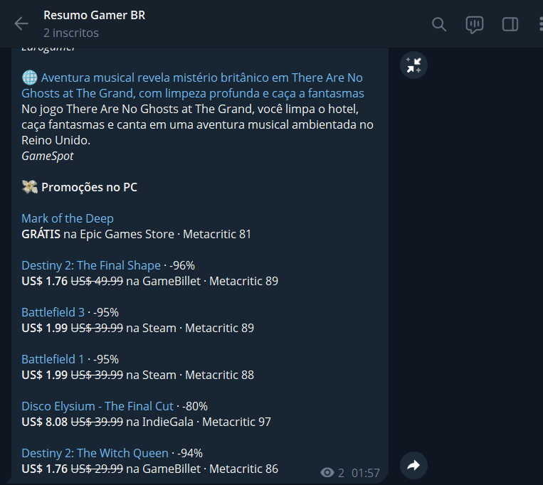

# 🕹️ Game News Bot

Bot que monta todo dia um **resumo de notícias e promoções de games** e envia no **Telegram**, **em português**. Ele lê os principais sites de games, separa por plataforma (PC, PlayStation, Xbox e Nintendo), junta a mesma notícia publicada em sites diferentes, traduz com IA, busca as melhores promoções de PC e nunca manda a mesma coisa duas vezes.


**📢 Veja funcionando:** [t.me/ResumoGamerBR](https://t.me/ResumoGamerBR)

## Como fica a mensagem

<p align="center"></p>

Em texto:

```
🕹️ Resumo gamer · 21/11/2026

📰 Notícias
🍄 Nintendo anuncia novo Zelda para o Switch 2
   A Nintendo revelou o próximo jogo da série. — GameSpot
🎮 PS5 Pro fica mais barato no Brasil
   A Sony reduziu o preço do console. — IGN
🟩 Xbox Game Pass recebe cinco jogos em dezembro — GameSpot
🌐 Demissões atingem mais um estúdio — IGN

💸 Promoções no PC
Hades · -75% — US$ 6.24 (era US$ 24.99) na Steam · Metacritic 93
Jogo Grátis — GRÁTIS na Epic Games Store
```

Cada título é um link. Os ícones mostram a plataforma: 🖥️ PC, 🎮 PlayStation, 🟩 Xbox, 🍄 Nintendo e 🌐 para notícias gerais do mundo dos games.

## Como funciona

```
  Feeds RSS (IGN, GameSpot,          API CheapShark
  Eurogamer, PC Gamer)               (promoções de PC)
          │                                 │
          ▼                                 ▼
   detecta plataforma               desconto e nota mínimos
   janela de 30 horas                       │
   palavras bloqueadas                      │
   junta notícias repetidas                 │
   no máximo 3 por site                     │
          └──────────────┬──────────────────┘
                         ▼
            SQLite: tira o que já foi enviado
                         ▼
     IA traduz tudo numa chamada só (OpenRouter → Groq
     → Gemini → SambaNova; se todos falharem, vai em inglês)
                         ▼
              Monta o resumo em HTML
                         ▼
             Telegram (divide se passar de 4096 caracteres)
```

- **Notícias repetidas:** a mesma notícia sai em vários sites com títulos diferentes. O bot compara os títulos sem acentos, pontuação e palavras vazias, e mantém só a mais recente.
- **Sem reenvio:** os links enviados ficam num SQLite. No GitHub Actions, esse arquivo é guardado em cache entre uma execução e outra.
- **Tradução com IA sem depender de um provedor:** a tradução usa o formato de chat da OpenAI, que OpenRouter, Groq, Gemini e SambaNova aceitam. O bot tenta na ordem do `config.yaml`, pula quem não tem chave e passa para o próximo se um falhar ou estourar o limite. As notícias do dia vão numa única chamada, então o uso cabe nos planos gratuitos.
- **RAG leve, feito para 1 GB de RAM:** todas as notícias coletadas (cerca de 180 por execução) entram num índice de busca de texto do SQLite (FTS5). As enviadas ficam em português, e as outras com o resumo do próprio site, sem gastar IA. No `/perguntar`, o bot acha as 8 notícias mais relevantes, **lê na hora o texto das 3 primeiras matérias** e a IA responde usando só esse material, citando cada fonte pelo número. Sem banco vetorial e sem modelo rodando na máquina. O arquivo guarda seis meses.
- **Ideias de vídeo:** o `/semana` pede para a IA agrupar as notícias da semana por assunto e ordena pelo que mais apareceu. Sem IA, uma contagem de palavras faz o mesmo papel.
- **Busca por significado (embeddings):** as notícias enviadas também ganham um vetor (Gemini, numa chamada por resumo). O `/perguntar` junta a busca por palavras com a por significado, então "jogo da Rockstar" acha notícias de GTA 6 mesmo sem a palavra "GTA". Os vetores ficam no próprio SQLite e a similaridade é calculada em Python, sem banco vetorial.
- **Sem repetição entre dias:** o mesmo assunto com outro título não volta por 3 dias, e a promoção do mesmo jogo, em outra loja, não volta por 7.
- **Prévia com imagem** só na primeira notícia de cada post, para o canal ficar visual sem poluir.
- **Operação:** backup semanal do banco enviado para o chat do dono (e sob demanda com `/backup`) e batimento para um monitor externo (Healthchecks.io), que avisa por e-mail se a máquina inteira cair.
- **Tolerante a falhas:** se um site ou a API de promoções cair, o resumo sai com o que estiver disponível.
- **Segredos fora do código:** o token do Telegram vem de variável de ambiente e nunca aparece nos logs, nem em mensagens de erro.

## Comandos no Telegram

No modo servidor (`python -m gamebot --escutar`), o bot fica ligado e responde:

| Comando | O que faz |
|---|---|
| `/agora` | Publica no canal as novidades deste momento |
| `/promocoes` | Mostra as promoções de PC na hora (sem IA) |
| `/perguntar <pergunta>` | Responde com base nas notícias guardadas, citando as fontes (RAG) |
| `/semana` | Ranking dos assuntos mais falados nos últimos 7 dias |
| `/roteiro` | Rascunho de roteiro de vídeo com as notícias da semana, com as fontes para citar |
| `/backup` | Manda uma cópia compactada do banco de notícias |
| `/status` | Mostra quando foi o último resumo |
| `/ajuda` | Lista os comandos |

Ao digitar `/` na conversa com o bot, o Telegram mostra esse menu com as descrições.

**Agenda automática** (no `config.yaml`): resumo em vários horários por dia (padrão 8h17, 13h17 e 19h17) e ranking da semana publicado no canal aos domingos. Se o bot reiniciar, ele não repete o que já publicou, e, se ficar fora do ar por horas, publica uma vez só ao voltar.

**Alertas:** quando um site não responde, as promoções falham ou a tradução cai em todos os provedores de IA, o bot avisa no chat do dono, no máximo uma vez por dia por problema.

Só o chat em `TELEGRAM_ADMIN_ID` (ou, se ele estiver vazio, o `TELEGRAM_CHAT_ID`) pode usar os comandos, para ninguém gastar a sua cota de IA.

### Publicar num canal

Para outras pessoas receberem o resumo, crie um canal público no Telegram, adicione o bot como **administrador** (com permissão de postar) e configure:

```
TELEGRAM_CHAT_ID=@NomeDoCanal     # o resumo vai para o canal
TELEGRAM_ADMIN_ID=123456789       # o id do seu chat: só você dá comandos
``` O passo a passo para deixar o bot ligado 24 horas de graça está em [docs/oracle-cloud.md](docs/oracle-cloud.md). No servidor, um timer do systemd confere o GitHub a cada 10 minutos e se atualiza sozinho quando há versão nova com o CI aprovado (entrega contínua por *pull*, sem abrir portas nem guardar a chave do servidor no GitHub).

## Configuração

Tudo fica no [`config.yaml`](config.yaml): plataformas, quantidade de itens, palavras bloqueadas, desconto mínimo das promoções e a lista de feeds. Para acrescentar um site, basta adicionar uma linha com o nome e a URL do RSS.

## Como usar

### 1. Criar o bot no Telegram

1. No Telegram, fale com o **@BotFather**, envie `/newbot` e siga os passos. Ele devolve o **token**.
2. Mande qualquer mensagem para o seu bot (ou adicione-o a um canal como administrador).
3. Abra `https://api.telegram.org/bot<TOKEN>/getUpdates` no navegador e copie o `chat.id`.

### 2. Rodar no seu computador

```bash
cp .env.example .env            # preencha TELEGRAM_TOKEN e TELEGRAM_CHAT_ID
pip install -r requirements.txt
python -m gamebot --dry-run     # mostra o resumo no terminal, sem enviar
python -m gamebot               # envia de verdade
```

Ou com Docker:

```bash
docker compose run --rm bot --dry-run   # uma execução de teste
docker compose up -d --build            # modo servidor, ligado 24 horas
```

### 3. Receber todo dia, de graça, com GitHub Actions

1. No repositório, vá em **Settings → Secrets and variables → Actions** e crie os secrets `TELEGRAM_TOKEN` e `TELEGRAM_CHAT_ID`.
   Para receber em português, crie também pelo menos um destes: `OPENROUTER_API_KEY`, `GROQ_API_KEY`, `GEMINI_API_KEY` ou `SAMBANOVA_API_KEY`.
2. Pronto. O workflow [`resumo-diario.yml`](.github/workflows/resumo-diario.yml) roda todo dia às 8h17 (horário de Brasília).
3. Para testar na hora: aba **Actions → Resumo diário → Run workflow**.

## Testes

```bash
pip install -r requirements-dev.txt
ruff check .
pytest -q
```

São 85 testes, que rodam sem internet, usando feeds e respostas de API salvos em `tests/fixtures`. Eles cobrem a detecção de plataforma, a junção de notícias repetidas, os filtros, as promoções (inclusive com a API fora do ar), a tradução (troca de provedor, resposta incompleta, nenhuma chave e chave fora dos logs), a formatação e a divisão da mensagem, o envio com erro o fluxo completo sem reenviar no dia seguinte e o modo servidor (comandos, chat não autorizado, horário do resumo diário e reinício sem repetir o resumo). O CI roda o linter (ruff) e todos os testes a cada push, e o servidor só se atualiza quando o CI passa.

## Próximos passos

- Comandos no bot, como `/promocoes` e `/noticias zelda`, com busca no histórico.
- Promoções de console (PlayStation Store, eShop e Xbox), que hoje não têm uma API pública simples.

## Estrutura

```
gamebot/
├── __main__.py      orquestra coleta → filtros → histórico → envio
├── config.py        lê config.yaml e variáveis de ambiente
├── models.py        Noticia e Promocao
├── plataformas.py   detecta PC, PlayStation, Xbox e Nintendo no texto
├── filtros.py       plataformas, palavras bloqueadas e repetidas
├── assistente.py    /perguntar (RAG) e /semana (ranking de assuntos)
├── banco.py         histórico em SQLite
├── resumo.py        monta e divide a mensagem
├── ia.py            tradução com OpenRouter, Groq, Gemini ou SambaNova
├── escuta.py        modo servidor: comandos e resumo diário
├── telegram.py      envio e leitura de mensagens pela Bot API
└── sources/
    ├── rss.py       leitura dos feeds
    ├── promocoes.py API da CheapShark (ofertas e menor preço da história)
    ├── gratis.py    API da GamerPower (jogos grátis por tempo limitado)
    └── cambio.py    API Frankfurter (dólar em reais)
```

## Promoções turbinadas (sem custo extra)

Cada promoção mostra o preço aproximado em reais (cotação da Frankfurter), avisa quando é o
🔥 menor preço da história (CheapShark) e quando 📉 caiu em relação ao que o bot viu nos últimos
30 dias (histórico guardado no SQLite). Uma seção 🎁 lista jogos grátis para resgatar, via GamerPower.

Todas as APIs são públicas e sem chave. Para gastar o mínimo de chamadas:

- **Cache com validade:** cotação 6 h, jogos grátis 3 h, menor preço histórico 7 dias.
- **Circuit breaker:** uma fonte que falha 3 vezes seguidas fica 6 h em pausa, e o dono recebe um alerta.
